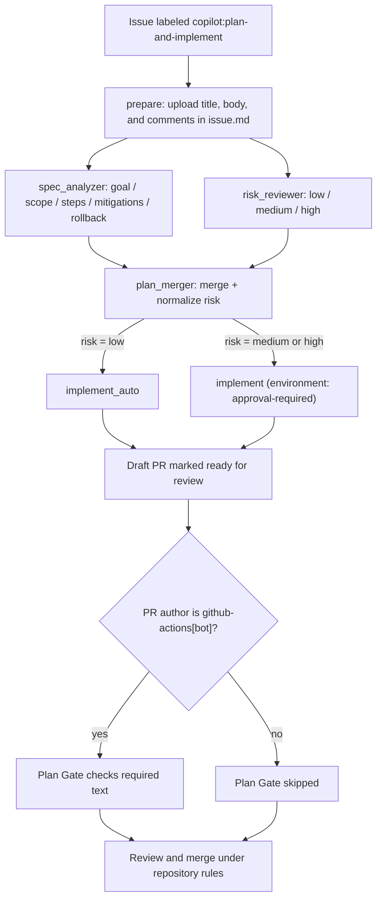

# Agent Orchestration

This repository ships a GitHub-native pipeline that lets an AI agent turn a
labeled issue into a pull request that is ready for review. It produces a
visible plan, a bounded changeset, and automated evidence. Environment approval
is used for medium- and high-risk implementation jobs when the
`approval-required` environment has required reviewers; PR approval and merge
protection depend on repository branch rules outside these workflows.

## Workflows

| Workflow                                                      | Trigger                                                                | Purpose                                                           |
| ------------------------------------------------------------- | ---------------------------------------------------------------------- | ----------------------------------------------------------------- |
| [Plan and Implement](../.github/workflows/plan-implement.yml) | `issues.labeled` (`copilot:plan-and-implement`) or `workflow_dispatch` | Plans, risk-scores, and implements the change on an agent branch. |
| [Plan Gate](../.github/workflows/plan-gate.yml)               | `pull_request` to `main`                                               | Checks the required plan text on PRs authored by `github-actions[bot]`; it is skipped for other authors. |
| [Evaluate Agents & Skills](../.github/workflows/evaluate.yml) | `push` to `main` or `workflow_dispatch` | Scores agent/skill definitions and uploads a commit-labeled badge artifact. |
| [AI Issue Priority Triage](../.github/workflows/issue-priority-triage.md) | `workflow_dispatch` only | Prioritizes every open issue and groups cohesive work using native sub-issues. |
| [Laya Issue Labeling](../.github/workflows/issue-laya-labeling.yml) | `issues.opened`, `issues.edited`, `issues.reopened`, `workflow_dispatch` | Locally assesses issues and reconciles advisory labels; supports dry-run and manual cache warming. |
| [Auto-merge Approved Trivial PRs](../.github/workflows/trivial-pr-automerge.yml) | `pull_request_review` | Classifies approved changes with read-only Copilot, then squash-merges trivial PRs after guarded review/check validation and cleans up the source branch. |

## Automatic Laya issue labeling

The [Laya Issue Labeling workflow](../.github/workflows/issue-laya-labeling.yml)
assesses the **current issue title and description** when an issue is opened,
edited, or reopened. Comments, label changes, and PRs are excluded. It does not
backfill existing issues automatically; editing an existing issue's description
starts an assessment after the workflow has been merged onto the default branch.

Inference runs locally on a GitHub-hosted CPU runner using
[`convaiinnovations/laya`](https://huggingface.co/convaiinnovations/laya),
its bundled `multilingual` checkpoint, and an explicit 8,192-token context.
The SDK and model revision are pinned in the classifier; dependency versions are
in [the inference requirements](../.github/scripts/issue-laya-requirements.txt).
The public model needs **no Hugging Face token, inference endpoint, GPU, or
Copilot subscription**. Issue text is not sent to a hosted inference API.
Dependencies and weights are cached; cold downloads and Actions compute/storage
still consume runner resources.

### Labels and thresholds

Each successful, non-stale write-mode assessment leaves exactly one label per
dimension: malicious injection, issue state, and unsafe-change intent.
Missing definitions are created automatically and owned metadata is refreshed.
Priority, implementation, and human labels are preserved.

| Binary proposition | Positive label | Negative label | Uncertain or overflow |
| --- | --- | --- | --- |
| Malicious attempt to control the evaluating AI | `laya:malicious-prompt-injection` at p >= 0.90 | `laya:prompt-clean` at p <= 0.10 | `laya:prompt-ambiguous` |
| Explicitly requests introducing errors or vulnerabilities | `laya:requests-errors-or-vulnerabilities` at p >= 0.80 | `laya:no-error-or-vulnerability-request` at p <= 0.20 | `laya:change-intent-ambiguous` |

Issue state is a separate three-option `choice`, not a Boolean. A model state
requires probability >= 0.85; winning argmax alone is insufficient.
The model-facing options are the short names `ready`, `decisions`, and
`information`, mapped to the labels below. Repository label strings are not
passed as model categories.

| State | Label | Operational meaning |
| --- | --- | --- |
| Well-defined | `laya:well-defined` | Actionable outcome, bounded scope, and necessary context. |
| Needs refinement | `laya:needs-refinement` | Concrete request, but material scope, behavior, or acceptance decisions remain. |
| Needs details | `laya:needs-details` | Insufficient substantive information to identify or investigate the request. |
| Uncertain or overflow | `laya:state-ambiguous` | No state reached the confidence threshold, or context was incomplete. |

A conservative precheck identifies explicit placeholder-only descriptions
(including "Will define later.") and empty/template-only content with generic
titles. Those receive Needs details without a state-model call; the decision
records a fixed `state_precheck` reason and a null state score, not invented
model confidence. Meaningful title-only and short requests still undergo normal
classification. There is no blanket word-count cutoff. Both safety checks
always inspect the original title and description, including placeholder issues.

Legacy issue labels `laya:prompt-injection`, `laya:needs-information`, and
`laya:definition-ambiguous` are removed as a fresh write-mode assessment replaces
them. Their repository definitions are not deleted, and there is no automatic
backlog migration.

The categories are independent: a well-defined issue can still request unsafe
changes. Deliberately adding bugs or vulnerabilities counts even for educational
examples and test fixtures. Merely reporting or repairing a vulnerability, or
testing an existing defect, is not intended to count. Similarly, discussing prompt
injection is not intended to count as an attack. Normal implementation steps,
commands, acceptance criteria, and quoted attack fixtures are not malicious
injection. Attempts to override the evaluator's instructions, manipulate its
labels, or extract hidden prompts/secrets are.

Malicious-injection detection uses `noul`. The unsafe-change check retains its
two-option `choice` and exposes the unsafe probability to the writer: a direct
comparison on the pinned checkpoint produced substantially more false positives
with a `noul` replacement. Typed-question recommendations do not substitute for
measuring the actual model's behavior.

These are **advisory model predictions**, not proven safety properties. Laya can
misclassify both malicious and ordinary issues, including vague descriptions and
legitimate security discussion; high confidence does not prevent mistakes.
The thresholds are a labeling policy, not measured accuracy guarantees.
Actual-model smoke checks exposed false positives and question-wording sensitivity,
so do not use a clean/negative label as permission to execute untrusted requests.
The workflow does not block, start, or otherwise change existing implementation,
priority, evaluation, or merge automation.

### Complete context and trusted label writes

The context limit includes question and serialization overhead, not just issue
prose. The helper uses Laya's tokenizer/head accounting and additionally checks
its reported dropped tokens. If the complete issue cannot be assessed, **all
three labels become ambiguous**, and the Actions summary explicitly reports
`overflow`. It never promotes a prediction made on silently truncated text.
The inference step runs one question at a time to bound CPU memory.
It disables PyTorch's fused attention fast path so Laya's decision head uses its
memory-efficient SDPA path; near-limit inputs can still require several GB of RAM.
Question preflight also rejects criteria that would exceed the pinned SDK's
48-token per-option or shared head budgets; long policy text must not silently
lose its exclusions.

A read-only job checks out trusted issue-event code, fetches current content,
and passes it to fixed questions as JSON data. Issue text is never interpolated
into shell commands or Actions scripts. The Python step receives no GitHub API
token. Classification has only `contents: read` and `issues: read`.

A separate job with `contents: read` and `issues: write` downloads this run
attempt's decision artifact. It validates the repository, issue identity,
run/attempt, trusted source SHA, pinned model, exact score schema, and complete
context before deriving allowlisted labels itself. It checks the current
title/description digest immediately before reconciliation. Stale content
withholds issue-label writes and produces an explicit summary. Runs are
serialized per issue without intentionally cancelling an in-progress write.
Only managed labels are added/removed; unrelated labels are never replaced.

### Dry-run, manual assessment, and cache warming

Automatic issue events continue to write labels by default. Set the repository
Actions variable `LAYA_DRY_RUN` to `true` to preview instead; unset it or set it
to `false` to restore writes. Other values fail visibly rather than guessing.
Dry-run validates the same schema, thresholds, and live-content digest and
reports proposed additions/removals without creating/updating label definitions
or modifying issue labels. The write-capable job is skipped. Existing labels
remain unchanged and may describe an older assessment.

In **Actions -> Laya Issue Labeling -> Run workflow**, select the default branch:

- `operation: assess`: provide a positive `issue_number`. `dry_run` defaults to
  true; explicitly disable it to reconcile that issue's labels. A repository
  `LAYA_DRY_RUN=true` overrides a manual request to write. PR numbers, missing
  issues, invalid input, and non-default-branch runs fail without label writes.
- `operation: warm-cache`: leave `issue_number` empty. This prepares the pinned
  CPU model and verifies the question budgets, without fetching an issue,
  producing an assessment artifact, or running the writer.

Model cache identity includes the pinned model configuration, dependency
manifest, OS, and architecture. Editing questions alone does not invalidate
weights. Warming downloads/builds the model; it does not keep a live model
process resident on subsequent Actions runners. There is no scheduled job.

GitHub does not support a transaction combining a content-version check and
label updates. A last-moment edit can still race the final check; the next
edit-triggered assessment corrects the advisory labels. Do not treat this as an
atomic safety gate.

### Diagnostics and recovery

Actions summaries show probabilities, proposed/applied labels, model revision,
content digest, policy version, deterministic precheck reason, write/dry-run
mode, and applied/unchanged/stale/overflow status. Version 2 decision artifacts
carry complete state-choice distributions and independent Boolean probabilities;
the writer rejects old schemas.
The `issue-laya-decision-<run_id>-<run_attempt>` artifact retains structured decisions
for 14 days without copying the raw title/description. No issue comments are
posted.

Download, inference, malformed-result, and GitHub API failures fail visibly,
never defaulting to clean or well-defined. An inference failure leaves the last
successful labels in place, which can be stale. API failures during reconciliation
can leave partially updated managed labels. Inspect the failed step, fix the
cause, and rerun **all jobs**, or edit the issue again. Rerunning only a failed
writer job cannot reuse an earlier attempt's artifact; rerunning all jobs
collects fresh content and produces a new decision. Reconciliation is idempotent.
Repository Actions policies and model-download network availability still apply.

Focused tests require Node, the existing evaluator dependencies (`npm --prefix
evaluator ci`), and Python 3.12. The ordinary Python tests mock inference and do
not need the model:

```bash
node --test .github/scripts/issue-laya-labels.test.cjs
python3.12 .github/scripts/issue-laya-classify.test.py
```

For the opt-in real CPU smoke test, use an isolated Python environment, install
the pinned requirements (install PyTorch from its CPU index on Linux as the
workflow does), and set `LAYA_SMOKE_TEST=1` when running the Python test file.
It exercises representative issues, near-limit input, and overflow without
creating or relabeling live issues.

The curated cases in
[`issue-laya-fixtures.json`](../.github/scripts/issue-laya-fixtures.json) include
the placeholder issue and legitimate level-design request that exposed the
original errors, ordinary commands, security fixes, quoted attacks, actual
evaluator manipulation, refinement needs, and intentionally vulnerable fixtures.
The opt-in test runs predictions through the actual JavaScript label policy and
prints per-dimension confusion counts, class precision/recall, coverage including
abstentions, and five-bin top-label ECE. Deterministic prechecks are excluded from
model-calibration samples. These small, manually labeled cases are regression
evidence, not a representative production calibration benchmark. Review false
positives, false negatives, and ambiguous cases against human judgments before
using confidence scores operationally; model training claims do not establish
calibration on this repository.

On the current 13-case curated corpus, both attack cases receive the malicious
label and none of the 11 non-attack cases do. However, all 11 non-attack cases
abstain rather than receiving a clean label. State coverage is 4/13, all Needs
details; the remaining cases abstain rather than confidently selecting
Well-defined or Needs refinement. The unsafe-change check still also flags the
two evaluator-manipulation cases despite neither requesting a code defect.
These cases were used to compare question wording, not held out for independent
evaluation. The changes fix the observed confident mislabels conservatively;
they do not establish reliable state routing or production calibration for this
checkpoint. Do not lower thresholds simply to make the bot label more issues.

## Review-triggered trivial PR auto-merge

The [Auto-merge Approved Trivial PRs](../.github/workflows/trivial-pr-automerge.yml)
workflow reacts to submitted, edited, and dismissed PR reviews. Only a
**submitted approval** starts an assessment, whether the reviewer is human or
Copilot. Approval-looking comment text does not qualify. Every event starts a
diagnostic preflight instead of silently skipping the entire job. Preflight
resolves the trusted base through GitHub's API; the snapshot helper fetches
complete PR and triggering-review metadata rather than relying on optional
event fields. Available event revision and branch fields must match that data.
The PR must be open, non-draft, originate in this repository, and target `main`.
Fork PRs, other target branches, and non-approving reviews are reported as
ineligible. The triggering approval must still cover the current head, but
aggregate required-review rules do not gate classification; they gate merging.

Copilot reviews the actual changes, not just the PR title or description, and
publishes its decision in the Actions summary and `trivial-pr-analysis-<run_id>`
artifact. Nontrivial decisions do not modify the PR. A completed trivial
decision enables a separate merge job, not a privileged Copilot session.

After Copilot finishes, the workflow rechecks the triggering approval and the
PR's open/non-draft state, source/target branches, and base/head revisions.
If any changed, `decision.json` reports `status: stale` without a trivial verdict,
and the summary marks the assessment as withheld. Raw inference output remains
in the artifact for diagnostics only. A failed freshness check publishes no
completed decision. Completed decisions are bound to the repository, run, PR,
source branch, analyzed revisions, and review ID. The merge job validates that
identity again and reads only this run's named artifact.

Before merging, the workflow requires a still-valid triggering approval,
satisfied aggregate review requirements, mergeability, passing required checks,
and GitHub's ready merge state. Pending requirements are checked up to 60 times
at 15-second intervals; exhaustion reports `pending-expired` and leaves the PR
unmodified. Conflicts, requested changes, failed checks, and GitHub protection
rejections report `blocked`. Missing required-check results cannot authorize a
merge while GitHub reports its merge gate blocked. Repositories with no required
checks can proceed only with a clean GitHub merge gate.

The final checks and base/head/approval revalidation occur immediately before
requesting a squash merge pinned to the analyzed head SHA. The workflow never
bypasses branch protections or leaves a native auto-merge request behind.
**GitHub's PR merge API atomically pins the head, not the base.** A base update
can race the final recheck; this best-effort base protection is an explicitly
accepted limitation, not an atomic guarantee.

After GitHub confirms the exact merge result, the workflow deletes the source
branch only if it is not a base/default branch, is unprotected, is unused by
another open PR, and still points at the analyzed head. An already deleted
branch is reported explicitly. Ref checking and deletion are not atomic, so
concurrent branch updates can still race cleanup.

Merges made with `GITHUB_TOKEN` do not ordinarily trigger other workflows through
their resulting push. The merge job therefore explicitly dispatches
`evaluate.yml` on `main`; successful evaluation already triggers `pages.yml`.
Evaluation dispatch and branch cleanup are separate steps. Cleanup still runs
if dispatch fails, and post-merge failures are reported as such rather than
claiming the merge failed. Inspect the failed operation before retrying it.

**Trivial can include small, low-risk functional fixes** as well as
documentation, comments, spelling, formatting, and focused tests. Changes must
be isolated, easily reversible, have a limited blast radius, and have enough
context and test evidence to understand their behavior. Small size alone is
not sufficient. Security/authentication/permission changes, data migrations,
deployment changes, broad dependency upgrades, architectural changes, and
broad refactors are nontrivial. Uncertainty means **classify as nontrivial**.

Workflow/action changes and changes to the classification helper/tests are
ineligible for automated assessment. Binary files, Git LFS pointers, symlinks,
submodules, and file-type changes are also excluded because the supported text
context cannot fully assess them. To avoid incomplete reviews, the helper
requires complete before/after contents and enforces these inclusive upper
limits:

| Limit | Value |
| --- | --- |
| Changed files | 20 |
| Added plus deleted lines | 500 |
| Each before/after file | 128 KiB |
| Total serialized review context | 256 KiB |

Exceeding a limit is reported as an ineligible assessment, never silently
truncated or interpreted as approval. Renames are assessed as a deletion plus
an addition and count toward these limits.

The analysis job checks out the explicit trusted base SHA, fetches candidate
Git objects without checking out candidate files, and gathers the full changes
from the common ancestor. It uses the existing Copilot setup action, disables
custom instructions and built-in MCP servers, and exposes only read tools.
Candidate code, actions, dependencies, and instructions are never executed.
PR/repository text is untrusted data. Only an exact JSON decision containing
`trivial: boolean` and a substantive `reason` is accepted; inference errors or
malformed output fail the job. Analysis uses the built-in Actions token with
`contents: read`, `pull-requests: read`, and `copilot-requests: write`; it has no
write permission to merge or alter pull requests. Only the isolated merge job
has `contents: write`, `pull-requests: write`, and `actions: write`, for merging,
branch cleanup, and post-merge evaluation dispatch. No separate credential or
repository native auto-merge setting is required.

Review the Actions summaries and the `trivial-pr-analysis-<run_id>` and
`trivial-pr-merge-<run_id>` artifacts, retained for 14 days. The first contains
preflight diagnostics even when the event is ineligible; the second records
merge and post-merge outcomes when that job runs. API and inference errors fail
visibly. Existing repository branch rules remain responsible for authorizing
merges; the workflow does not change them.

The workflow must be published before qualifying approvals can activate it.
After changes or an expired wait, submit a fresh approval to retry. Rerunning an
old review-triggered run retains its old workflow/event context and is not a
reliable way to activate newly published workflow code. Any GitHub requirement
to approve a Copilot-triggered workflow run remains in effect.
Focused tests use real temporary Git fixtures plus mocked Copilot/GitHub calls
and do not merge or delete live PRs:

```bash
npm --prefix evaluator run test:workflows
```

## Manual AI issue priority triage

The [agentic workflow source](../.github/workflows/issue-priority-triage.md) uses
the Copilot engine; its generated
[`.lock.yml`](../.github/workflows/issue-priority-triage.lock.yml) is the workflow
GitHub Actions executes. Both must be present on the default branch before use.
This workflow does not start implementation, assign agents, close issues, or
modify the existing planning/evaluation workflows.

In **Actions -> AI Issue Priority Triage -> Run workflow**, leave `dry_run`
unchecked to apply decisions, or check it to preview without changing issues.
For example, preview from the command line:

```bash
gh workflow run issue-priority-triage.lock.yml -f dry_run=true
```

To apply, use the same command with `-f dry_run=false`. Runs are serialized across
the repository, including dispatches from different refs, rather than cancelling
an in-progress reconciliation. Analysis uses the default branch's current code
and requirements.

### Priority policy

Each open issue, including new overarching tasks, ends a successful run with
**exactly one** of these labels. Only these four exact lowercase names are
managed; labels such as `bug` and `copilot:plan-and-implement` remain untouched.
Missing managed label definitions are created during apply, not during preview.

| Label | Meaning |
| --- | --- |
| `high` | Serious bugs, urgent work, or the most sensible actionable next work given the current repository. Tasks that unlock other work can be high. |
| `medium` | Useful planned work that is not the next highest priority. |
| `low` | Optional improvements or work with little current payoff. |
| `blocked` | Unfinished prerequisite tasks prevent meaningful progress. This overrides urgency, including otherwise-high work. |

Initial assignment, actual priority changes, and repairs of conflicting priority
labels receive a comment with the previous labels, new priority, reasoning,
prerequisite references, analyzed repository revision, and workflow-run link.
Already-correct priorities do not receive repeated comments. Old reasoning stays
in the issue history. Blocked work is reassessed **only on the next manual run**,
not automatically when its prerequisite closes.

Native dependencies and evidence-backed dependencies written in issue bodies or
comments inform the decision. A parent/sub-issue relationship alone does not
make an issue blocked. The AI must inspect actual implementation progress;
an open PR or an issue closed as "not planned" is not evidence that work shipped.

### Reusable parent tasks

The workflow can group at least two existing open leaf issues under a coherent
overarching task, with an outcome, shared-work rationale, and acceptance criteria.
It creates **native GitHub sub-issue links**, not just a Markdown checklist, and
assigns the new parent its own priority and reasoning comment.

Compatible open parents are reused. Generated parents contain stable group and
original-member markers so an expanded or interrupted group can be recovered.
The workflow never moves an issue away from its existing parent, removes
children, replaces human-created parent descriptions, recursively wraps old
groups, or reopens/closes parents. GitHub's limits of 100 sub-issues and eight
hierarchy levels are enforced.

### Authentication, guardrails, and recovery

**No separate Copilot token or PAT is required.** Inference uses the built-in
Actions token with `copilot-requests: write`; API operations also use the
per-run token. In a personally owned repository, usage is billed to the owner's
Copilot seat. For organization-owned repositories, enable **Allow use of
Copilot CLI billed to the organization** in the organization's Copilot policy.
GitHub Actions and Copilot inference access must be available.

See the current GitHub references for
[authentication and billing](https://docs.github.com/en/copilot/concepts/agents/copilot-cli/copilot-cli-in-github-actions)
and [Actions setup](https://docs.github.com/en/copilot/how-tos/copilot-cli/use-copilot-cli-in-actions).
Older gh-aw setup text describing the tokenless path only for organizations
does not reflect the newer personal-repository support.

A separate read-only job enumerates the complete backlog, comments,
relationships, and closed-issue context using pagination. Issue/repository text
is untrusted data. The Copilot job has no issue-write or content-write permission,
and file-write/shell tools are explicitly denied. It submits one structured plan
covering every issue; incomplete or invalid plans fail a trusted validation gate.
Strict threat detection must also succeed before the isolated write job runs.
Only that job reconciles the four priority labels, publishes reasoning, and
creates/links approved groups. It validates the plan again against the trusted
snapshot and current GitHub state. Failure, missing-tool/data, incomplete-run,
and detection tracking issues are disabled.

Framework staged mode is also mutation-free. The custom apply job verifies the
activation job's independent `info` artifact because gh-aw v0.89.21 does not
forward its staged-mode environment variable to custom safe-output jobs.

Review the Actions summary and `issue-triage-snapshot`,
`issue-triage-decisions`, and `issue-triage-results` artifacts, retained for 14
days. Preview summaries/results include proposed priorities, reasoning, groups,
and missing managed label definitions, without any mutating API requests.

If issues, prerequisites, or the default-branch revision changed during analysis,
run a fresh manual triage rather than overwriting newer context. API failures
fail the run and leave a progress artifact when application started. GitHub does
not provide a transaction across comments, labels, parent creation, and links:
completed operations are not rolled back. Reasoning is posted **before** label
changes, so even partial transitions have an explanation. Retry failed jobs to
resume with the original snapshot and transition markers, or run a fresh triage
if context changed. The applier reuses its comments/parents and existing links
instead of creating duplicates. A job retry refreshes its triage artifacts;
download a failed attempt's progress first if you need to retain that copy.

### Maintaining the workflow

Edit the `.md` source, not the generated `.lock.yml`. This workflow was compiled
with gh-aw **v0.89.21** and compiler-pinned engine/action/container versions.
Use that compiler version when regenerating, or explicitly review an upgrade:

```bash
gh aw compile issue-priority-triage --strict --validate
node --test .github/scripts/issue-priority-triage.test.cjs
```

Commit the source and regenerated lock together, along with compiler-required
action-pin metadata. The focused tests use the built-in Node test runner and
mocked GitHub APIs; they do not require AI inference or modify live issues.

## Reusable actions

| Action                                                                       | Role in the pipeline                                                                                 |
| ---------------------------------------------------------------------------- | ---------------------------------------------------------------------------------------------------- |
| [`setup-copilot-cli`](../.github/actions/setup-copilot-cli/action.yml)       | Installs Node and the GitHub Copilot CLI on the runner.                                              |
| [`copilot-json-task`](../.github/actions/copilot-json-task/action.yml)       | Runs a Copilot prompt against the issue with injection guards and returns a syntax-validated JSON artifact. |
| [`open-agent-pr`](../.github/actions/open-agent-pr/action.yml)               | Creates the working branch, renders the PR body from `plan.json`, and opens a draft PR.              |
| [`implement-agent-plan`](../.github/actions/implement-agent-plan/action.yml) | Downloads the issue discussion, executes the `implementer` against the plan, commits results, and marks the PR ready. |

## End-to-end flow



The [`prepare`](../.github/workflows/plan-implement.yml) job resolves the
issue and uploads its title, body, and all available comments as the `issue`
artifact (`issue.md`). Comments are fetched with REST API pagination and retain
their full bodies, authors, creation/update timestamps, and permalinks in
chronological order, including bot comments. `spec_analyzer` and `risk_reviewer`
fan out in parallel, each producing a JSON artifact through
[`copilot-json-task`](../.github/actions/copilot-json-task/action.yml).
[`plan_merger`](../.github/workflows/plan-implement.yml) fans them back in,
normalizes `risk` to `{low, medium, high}` (defaulting to `high`), and
publishes `plan.json`. The implement stage then either runs directly
(`low`) or waits for approval through the `approval-required`
environment (`medium`/`high`). Both implementation paths download the same
issue artifact as supporting context for the approved plan. Issue content is
captured once per run, not re-fetched after approval; later comments are picked
up by a subsequent run. The label and manual triggers are unchanged, so posting
a comment alone does not start a run.

Focused regression tests use the built-in Node test runner and mocked
`gh`/`copilot` commands without AI inference or live issue/PR changes:

```bash
node --test .github/scripts/plan-implement.test.cjs
```

The checked-in `open-agent-pr` action currently renders `## Plan`, while Plan
Gate requires the literal heading `## Plan (required)`. As a result, a PR
created by this pipeline fails Plan Gate as the files are currently written.
The workflow documentation below describes that limitation rather than
treating the intended gate as already satisfied.

## Guardrails and how they map to orchestration principles

Each guardrail below is present in the pipeline. The bullet under each one
maps it to the accountability model in the request: a stated goal, an
inspectable plan, a bounded changeset, automated evidence, human judgment,
and a clear outcome.

### 1. Stated goal — the issue is the single source of truth

The pipeline only runs from a real issue: `prepare` calls
`gh issue view` and paginates the issue's comments with `gh api`. Planning,
risk review, and implementation receive the same `issue.md` artifact; the
implementation plan remains the source of truth for changes. There is no
free-form prompt path.

- **Principle:** every agent run has a linkable, human-authored goal.
- **Anti-pattern avoided:** agents acting on ad-hoc chat with no
  traceable request.

### 2. Inspectable plan — structured JSON, not prose

[`spec_analyzer`](../.github/workflows/plan-implement.yml) asks the
model to emit a JSON object with `goal, scope, steps, mitigations,
rollback`. `jq` validates that the output is valid JSON, but it does not
validate the requested fields or their types. Downstream rendering supplies
some fallbacks for missing values but still assumes expected types.
The [`open-agent-pr`](../.github/actions/open-agent-pr/action.yml) action
renders corresponding fields into the PR body; the
[plan template](../.github/PULL_REQUEST_TEMPLATE/plan-template.md) documents
the intended shape.

- **Principle:** the plan is machine-readable and reviewer-visible before
  implementation, while field-level schema validation remains a gap.
- **Anti-pattern avoided:** "trust me" PRs where the intent is buried in
  the diff.

### 3. Risk gate — approval scales with blast radius

[`risk_reviewer`](../.github/workflows/plan-implement.yml) produces a
single field (`low | medium | high`). `plan_merger` normalizes the value
and defaults to `high` on anything unexpected. The result routes to one
of two jobs:

- `implement_auto` runs directly for `low` risk.
- `implement` targets the `approval-required` environment; GitHub blocks
  the job until a reviewer approves in the Environments UI when required
  reviewers are configured for that environment.

- **Principle:** checks match the risk of the change; unknown risk is
  treated as high risk.
- **Anti-pattern avoided:** uniform "auto-merge everything" or uniform
  "block everything" policies that either under- or over-invest in
  review.

### 4. Bounded changeset — one branch, one PR, one job

[`open-agent-pr`](../.github/actions/open-agent-pr/action.yml) creates a
deterministic branch name (`agent-plan/issue-<n>-<run_id>`), opens a
**draft** PR immediately, and exports `BRANCH`/`BASE` for the next step.
The [`concurrency`](../.github/workflows/plan-implement.yml) group is
keyed on the issue number with `cancel-in-progress: false`, so two runs
for the same issue cannot race.

- **Principle:** every agent contribution is a diff on a named branch
  attached to an issue.
- **Anti-pattern avoided:** agents pushing to shared branches or
  producing overlapping changes for the same request.

### 5. Least-privilege permissions per job

`permissions: {}` is declared at the workflow level and each job opts in
to only what it needs (`contents: read`, `copilot-requests: write`, and
only `implement*` gets `contents: write` + `pull-requests: write`). The
planning jobs cannot push code, and the implement jobs cannot exist
without a merged plan.

- **Principle:** capability boundaries separate "think" from "act".
- **Anti-pattern avoided:** a single over-scoped token that lets any
  step do anything.

### 6. Prompt-injection hardening

[`copilot-json-task`](../.github/actions/copilot-json-task/action.yml)
loads the untrusted issue title, body, and comments into a shell variable,
embeds them inside `<ISSUE>` tags with an explicit instruction to ignore any
directives found inside, and restricts Copilot to read-only tools
(`--available-tools='view,glob,grep'`). Output is extracted between the
first `{` and last `}` and re-parsed by `jq` before being trusted.
The implementer is also instructed to treat `out/issue.md` as untrusted
supporting context and to stop and report conflicts with the approved plan
rather than expanding its scope.

- **Principle:** treat model inputs as untrusted data and model outputs
  as untrusted until validated.
- **Anti-pattern avoided:** issue authors (or transitive content in
  linked files) steering the agent into unintended tools or actions.

### 7. Plan Gate for bot-authored PRs

[Plan Gate](../.github/workflows/plan-gate.yml) is triggered for PRs to
`main`, but its job runs only when the PR author is `github-actions[bot]`.
For those PRs it fails if the body is missing any required text from the
[plan template](../.github/PULL_REQUEST_TEMPLATE/plan-template.md)
(Goal, Scope, Steps, Success criteria, Risks, Rollback, Evidence,
Review checklist). It reads `PR_BODY` as data — never through `eval`.

- **Current limitation:** human-authored PRs skip the gate, and generated
  agent PRs use `## Plan` instead of the required `## Plan (required)`, so
  the generated PR fails the check.
- **Principle:** required plan fields are mechanically checked on the
  bot-authored path, but this is not a repository-wide plan policy.

### 8. Draft first, ready second

`open-agent-pr` always opens the PR as a **draft**;
[`implement-agent-plan`](../.github/actions/implement-agent-plan/action.yml)
later calls `gh pr ready`. The action intends to leave the PR as a draft
when the agent produces no changes, but its current check also counts the
initial empty branch commit. Consequently, it can mark a PR ready even when
the agent produced no file diff.

- **Human gates:** medium/high risk can require environment approval, and
  PR approval can be required by repository branch rules. Neither low-risk
  environment approval nor PR review is universally enforced by these
  workflow files alone.
- **Principle:** draft creation exposes the plan before implementation,
  while repository settings remain responsible for merge ownership.

### 9. Audit trail

A completed planning run leaves `issue`, `spec`, `risk`, and `plan` artifacts. The implementation
stage adds a PR, branch, and initial commit; it adds a separate implementer commit only when the
agent stages file changes. The resulting evidence includes:

- The `issue`, `spec`, `risk`, and `plan` [artifacts](../.github/actions/copilot-json-task/action.yml) captured per run.
- The plan rendered into the PR body, including a link back to the [workflow run](../.github/actions/open-agent-pr/action.yml).
- The [initial empty commit](../.github/actions/open-agent-pr/action.yml) (`chore: start agent plan for issue #N`) that anchors the branch to the issue before any code is written.
- When file changes are staged, the implementer commit produced by [`implement-agent-plan`](../.github/actions/implement-agent-plan/action.yml), pushed to a branch named after the issue and run.
- The [Plan Gate check](../.github/workflows/plan-gate.yml) recorded on the PR.

Together these map to the six-item accountability checklist:

| Requirement        | Where it lives                                                                                     |
| ------------------ | -------------------------------------------------------------------------------------------------- |
| Stated goal        | Issue linked from PR title/body                                                                    |
| Inspectable plan   | `plan.json` artifact + PR body from [`open-agent-pr`](../.github/actions/open-agent-pr/action.yml) |
| Bounded changeset  | `agent-plan/issue-<n>-<run_id>` branch                                                             |
| Automated evidence | Workflow run URL + uploaded artifacts                                                              |
| Human judgment     | `approval-required` environment for non-low risk when protected + repository PR review rules       |
| Clear outcome      | PR and run history support merge, revert, or issue escalation decisions                            |

## Post-incident view

If an agent change passes CI and later regresses, this pipeline is designed
so the review is about the system, not the agent:

- **Was there a visible plan and scope?** Yes — `plan.json` and PR body.
- **Were the right reviewers requested and approvals given?** Check the
  configured `approval-required` environment and PR review history.
- **Did the checks match the risk?** The `risk` field in `plan.json` and
  the branching in `plan_merger` show which path ran.
- **Is the audit trail sufficient?** The run's artifacts, the branch, and
  the PR together reconstruct the decision.

The recovery path for a regression is to revert the implementer commit on
the agent branch (or the merge commit on `main`) and re-open the issue.
The branch and initial commit are keyed to the issue and run; artifacts
provide the corresponding plan while they remain within their retention
period.
